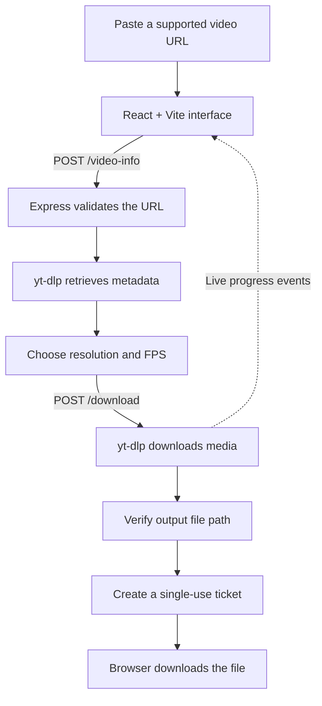

<!--
  SONIC Downloader · project README
  The animated, custom-lettered wordmark is stored locally in assets/.
-->

<p align="center">
  <a href="https://github.com/KRISHBHADWAL/sonic-downloader">
    
  </a>
</p>

<p align="center">
  <strong>A sleek, local-first media downloader with a neon edge.</strong>
  <br />
  Inspect available formats, choose your quality, and follow the download pipeline in real time.
</p>

<p align="center">
  <a href="https://github.com/KRISHBHADWAL/sonic-downloader/actions/workflows/ci.yml">
    
  </a>
  
  
  
  
</p>

<p align="center">
  <a href="#-features">Features</a> ·
  <a href="#-quick-start">Quick start</a> ·
  <a href="#-how-it-works">How it works</a> ·
  <a href="#-api-reference">API</a> ·
  <a href="#-security--limitations">Security</a>
</p>

---

## ⚡ Features

| | Capability | What it does |
|:--:|---|---|
| ◈ | **Format discovery** | Fetches video metadata and available download formats before you commit to a quality. |
| ⬡ | **Quality controls** | Choose a resolution and available frame rate from the formats returned by yt-dlp. |
| ▰ | **Live progress** | Streams yt-dlp progress events to the neon progress bar using Server-Sent Events. |
| ↓ | **Native downloads** | Delivers completed files through the browser's download manager instead of buffering the whole file in the UI. |
| ⛨ | **Safer execution** | Uses shell-free process execution, a source-host allowlist, output-path checks, and short-lived single-use download tickets. |
| ◉ | **Local-first setup** | Runs the React interface and Express API on your own machine. No platform account or app login is implemented. |

**Supported source hosts:** YouTube, Instagram, and Snapchat (subject to public availability and platform changes).

## ✨ Interface

The app uses a dark cyberpunk visual system: neon cyan and violet accents, glowing controls, a responsive layout, and a live download pipeline. Its progress bar reflects the percentage reported by yt-dlp while media is being prepared on the backend.

> [!NOTE]
> The progress bar tracks the backend media download. Once the file is ready, the browser takes over the final transfer and displays its own download progress.

## 🧭 How it works



### Request lifecycle

1. The interface submits the URL to `POST /video-info`.
2. The API validates the URL and asks yt-dlp for metadata and available formats.
3. You select a resolution and, where available, a frame rate.
4. The interface opens a streaming request to `POST /download`.
5. The API forwards yt-dlp progress as Server-Sent Events.
6. When yt-dlp finishes, the API verifies the output file, creates a 10-minute single-use ticket, and sends a completion event.
7. The browser opens the ticket URL and receives the file as an attachment.

## 🧰 Tech stack

| Layer | Technology | Role |
|---|---|---|
| Frontend | React 18 | Interactive downloader interface |
| Build tooling | Vite | Development server and production bundling |
| Frontend tests | Vitest + Testing Library | UI smoke tests |
| Backend | Node.js + Express | Validation, process orchestration, and file delivery |
| Media engine | yt-dlp | Metadata extraction and media downloads |
| Backend tests | Node.js test runner | API helper and validation tests |

## 🚀 Quick start

### Prerequisites

- **Node.js 22.12 or newer**
- **Python 3.9 or newer**
- **pip** and a working Python installation
- Internet access for supported public media sources

### 1. Start the frontend

From the repository root:

```bash
npm ci
npm start
```

The Vite development server starts at **http://127.0.0.1:5173**.

### 2. Start the backend

Open a second terminal:

```bash
cd backend
npm ci
python3 -m pip install --upgrade yt-dlp
cp .env.example .env
npm start
```

The API starts at **http://127.0.0.1:4000**.

Open the frontend, paste a supported URL, select **Analyse link**, choose a quality, and start the download.

<details>
<summary><strong>Windows PowerShell setup</strong></summary>

Run the frontend commands from the repository root as shown above.

For the backend:

```powershell
cd backend
npm ci
py -m pip install --upgrade yt-dlp
Copy-Item .env.example .env
```

Open `backend/.env` and set:

```dotenv
PYTHON_COMMAND=py
```

Then start the API:

```powershell
npm start
```

</details>

## ⚙️ Configuration

The defaults are suitable for local development. Change them only when your environment requires it.

### Frontend — root `.env`

| Variable | Default | Purpose |
|---|---|---|
| `VITE_API_BASE_URL` | `http://127.0.0.1:4000` | Backend API origin used by the browser |

### Backend — `backend/.env`

| Variable | Default | Purpose |
|---|---|---|
| `PORT` | `4000` | API port |
| `HOST` | `127.0.0.1` | Bind address |
| `CORS_ORIGIN` | `http://127.0.0.1:5173` | Exact allowed frontend origin |
| `PYTHON_COMMAND` | `python3` (or `py` on Windows) | Python executable used to launch yt-dlp |
| `DOWNLOAD_DIR` | `./downloads` | Backend download storage directory |
| `YTDLP_TIMEOUT_MS` | `600000` | Maximum media operation duration |
| `ALLOWED_VIDEO_HOSTS` | Hosts listed in `backend/.env.example` | Comma-separated source-host allowlist |

Keep the frontend and backend origins aligned. For example, if the frontend is served from `http://localhost:5173`, set `CORS_ORIGIN=http://localhost:5173` in the backend environment.

## 🔌 API reference

| Method | Endpoint | Purpose |
|:--:|---|---|
| `GET` | `/health` | Returns API health status. |
| `POST` | `/video-info` | Accepts a URL and returns the title, duration, thumbnail, and curated formats. |
| `POST` | `/download` | Accepts a URL, resolution, and optional FPS; streams progress, completion, or failure events. |
| `GET` | `/download/:ticket` | Streams the completed file as a browser attachment using a single-use ticket. |

### Download event stream

The `POST /download` response is a Server-Sent Events stream:

- `progress` — contains the reported percentage and current stage.
- `complete` — contains the temporary `downloadUrl`, filename, and expiry.
- `failure` — contains a safe error message.

Example request body:

```json
{
  "url": "https://www.youtube.com/watch?v=VIDEO_ID",
  "resolution": "1080",
  "fps": null
}
```

The completion event returns a relative download URL. The frontend resolves it against the configured API origin and checks that it stays on that same origin before opening it.

## 🧪 Development

Run the frontend checks from the repository root:

```bash
npm test
npm run build
```

Run backend tests from the `backend` directory:

```bash
npm test
```

Useful frontend commands:

| Command | Description |
|---|---|
| `npm start` | Start the Vite development server |
| `npm run dev` | Alias for the Vite development server |
| `npm test` | Run the Vitest suite once |
| `npm run build` | Create the production build in `dist/` |
| `npm run preview` | Preview the production build locally |

## 🛡️ Security & limitations

- yt-dlp is launched with `spawn(..., { shell: false })`; user-provided URLs are not interpolated into a shell command.
- Source URLs are checked against an exact hostname allowlist.
- Output paths are resolved and checked to ensure the delivered file is a regular file inside the configured download directory.
- Download tickets are random, single-use, expire after **10 minutes**, and do not reveal filesystem paths.
- There is **no platform login, OAuth, cookie, or token flow**. Do not add passwords, browser session exports, or access tokens to source code, request bodies, or logs.
- Tickets are held in memory and are intended for a single backend instance. Restarting the API invalidates outstanding tickets.
- Downloaded files remain on the backend after delivery. Configure retention cleanup for long-running installations.

> [!WARNING]
> This project is intended for local use. A hostname allowlist alone is not a complete SSRF defence. Before exposing the API publicly, add authentication, rate limiting, per-user quotas, DNS/IP and redirect validation, network-level egress restrictions, persistent ticket handling, and download cleanup. Review platform terms and only save media you are authorised to download.

## 📁 Project layout

```text
sonic-downloader/
├── src/
│   ├── App.jsx
│   ├── App.test.jsx
│   ├── Downloader.jsx
│   ├── Downloader.css
│   ├── index.css
│   └── index.jsx
├── backend/
│   ├── server.js
│   ├── server.test.js
│   ├── .env.example
│   └── README.md
├── .github/
│   └── workflows/
│       └── ci.yml
├── index.html
├── package.json
├── vite.config.mjs
└── README.md
```

---

<p align="center">
  <strong>SONIC ⚡ DOWNLOADER</strong>
  <br />
  <sub>Built for speed. Designed for the dark.</sub>
  <br /><br />
  <a href="https://github.com/KRISHBHADWAL/sonic-downloader">Repository</a> ·
  <a href="https://github.com/KRISHBHADWAL/sonic-downloader/issues">Report an issue</a>
</p>
