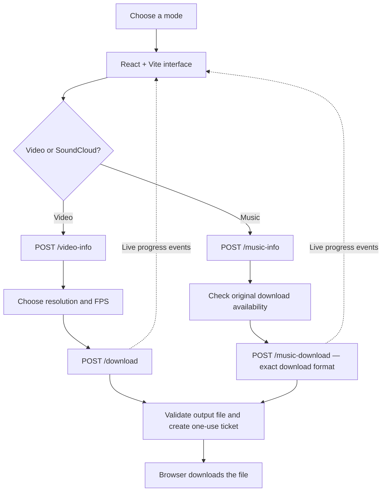

<!--
  SONIC Downloader · main project README
  Animated wordmark maintained locally in assets/sonic-banner.gif.
-->

<p align="center">
  <a href="https://github.com/KRISHBHADWAL/sonic-downloader">
    
  </a>
</p>

<p align="center">
  <strong>One workspace for video downloads and SoundCloud music originals.</strong>
  <br />
  Switch modes, inspect media, and follow the download pipeline in a neon-lit interface.
</p>

<p align="center">
  <a href="https://github.com/KRISHBHADWAL/sonic-downloader/actions/workflows/ci.yml">
    
  </a>
  
  
  
  
</p>

<p align="center">
  <a href="#-what-is-sonic">Overview</a> ·
  <a href="#-modes--features">Modes & features</a> ·
  <a href="#-quick-start">Quick start</a> ·
  <a href="#-configuration">Configuration</a> ·
  <a href="#-api-reference">API</a> ·
  <a href="#-security--permissions">Security</a>
</p>

---

## ⚡ What is SONIC?

**SONIC Downloader** is a local-first media utility built around one compact interface and two modes:

- **VIDEO** — inspect available formats, choose a resolution and frame rate, and download supported videos.
- **MUSIC** — inspect individual SoundCloud tracks and download the original audio file only when SoundCloud makes that file available.

Both modes share the same neon interface, live preparation progress, secure file-delivery flow, and local Express backend.

## 🎛️ Modes & features

| Mode | Sources | What you can do |
|:--|:--|:--|
| **VIDEO** | YouTube, Instagram, Snapchat | Analyse a link, inspect available video formats, choose resolution and FPS, and download the result. |
| **MUSIC** | Individual SoundCloud tracks | View artwork, title, artist and duration; check original-download availability; save the original file when enabled by the uploader. |

### Shared features

| Feature | Details |
|---|---|
| **Two-mode switch** | Switch between VIDEO and MUSIC without leaving the page. Each mode presents the controls relevant to that media type. |
| **Format discovery** | Retrieves media metadata before starting a download. |
| **Live progress** | Streams yt-dlp preparation progress to the animated progress bar using Server-Sent Events. |
| **Native file delivery** | Once the backend has prepared a file, the browser handles the final download. |
| **Cyberpunk UI** | Dark interface, neon cyan and violet accents, pink SoundCloud mode, animated status details, and responsive layouts. |
| **Local-first execution** | The React interface and Express API run on your machine. |

### SoundCloud download rules

SoundCloud music mode intentionally supports **original downloadable track files**, not stream capture.

- Only individual track URLs are accepted; playlist and profile URLs are rejected.
- The API checks for SoundCloud's original `download` format.
- The download endpoint explicitly requests that format. It does not fall back to regular audio streams or HLS.
- When no original download is available, the UI marks the track as stream-only and disables the download action.
- SoundCloud's download flow requires a signed-in listener, and the uploader must have enabled downloads. SoundCloud does not provide whole-playlist downloads through this flow.

See [SoundCloud's download guidance](https://help.soundcloud.com/hc/en-us/articles/115003448787-Downloading-tracks).

> [!IMPORTANT]
> Only download media you own or are authorised to save. The app does not unlock tracks whose creators have disabled downloads.

## 🧭 How it works



### File delivery lifecycle

1. The frontend sends a media URL to the matching information endpoint.
2. The backend validates the URL and asks yt-dlp for metadata.
3. Video mode presents available resolution/FPS choices. Music mode presents track details and original-download availability.
4. The frontend starts the matching download endpoint and reads its Server-Sent Events.
5. After yt-dlp finishes, the backend verifies that the output is a regular file inside the configured download directory.
6. The backend creates a random, single-use download ticket that expires after 10 minutes.
7. The browser opens the ticket URL and manages the final file transfer.

The progress bar reflects backend media preparation. Browser-native download progress takes over after the file is ready.

## 🧰 Tech stack

| Layer | Technology | Purpose |
|---|---|---|
| Frontend | React 18 | Interactive two-mode interface |
| Build tooling | Vite | Development server and production bundling |
| Frontend tests | Vitest + Testing Library | UI and mode-switch tests |
| Backend | Node.js + Express | URL validation, media-process orchestration, and file delivery |
| Media engine | yt-dlp | Metadata extraction and permitted media downloads |
| Backend tests | Node.js test runner | URL validation, format checks, progress parsing, and file-delivery helpers |

## 🚀 Quick start

### Prerequisites

- **Node.js 22.12 or newer**
- **Python 3.9 or newer**
- **pip**
- Internet access for supported media sources

### 1. Start the frontend

From the repository root:

```bash
npm ci
npm start
```

The Vite development server starts at **http://127.0.0.1:5173**.

### 2. Start the backend

Open a second terminal:

```bash
cd backend
npm ci
python3 -m pip install --upgrade yt-dlp
cp .env.example .env
npm start
```

The API starts at **http://127.0.0.1:4000**.

Open the frontend, choose **VIDEO** or **MUSIC**, paste a supported URL, and follow the on-screen controls.

<details>
<summary><strong>Windows PowerShell setup</strong></summary>

Run the frontend commands from the repository root as shown above.

For the backend:

```powershell
cd backend
npm ci
py -m pip install --upgrade yt-dlp
Copy-Item .env.example .env
```

Open `backend/.env` and set:

```dotenv
PYTHON_COMMAND=py
```

Then start the API:

```powershell
npm start
```

</details>

## ⚙️ Configuration

The defaults are suitable for local development.

### Frontend — root `.env`

| Variable | Default | Purpose |
|---|---|---|
| `VITE_API_BASE_URL` | `http://127.0.0.1:4000` | Backend API origin used by the browser |

### Backend — `backend/.env`

| Variable | Default | Purpose |
|---|---|---|
| `PORT` | `4000` | API port |
| `HOST` | `127.0.0.1` | Bind address |
| `CORS_ORIGIN` | `http://127.0.0.1:5173` | Exact allowed frontend origin |
| `PYTHON_COMMAND` | `python3` (or `py` on Windows) | Python executable used to launch yt-dlp |
| `DOWNLOAD_DIR` | `./downloads` | Backend download storage directory |
| `YTDLP_TIMEOUT_MS` | `600000` | Maximum media operation duration |
| `ALLOWED_VIDEO_HOSTS` | See `backend/.env.example` | Comma-separated video source-host allowlist |
| `SOUNDCLOUD_COOKIES_FILE` | Unset | Optional path to your own signed-in SoundCloud Netscape-format cookie file |

Keep the frontend and backend origins aligned. For example, if the frontend is served from `http://localhost:5173`, set `CORS_ORIGIN=http://localhost:5173` in the backend environment.

### Optional: signed-in SoundCloud session

Some SoundCloud original-download requests may need your signed-in session. To configure your own local cookie file:

1. Obtain a Netscape-format cookie file for your own SoundCloud account using a trusted local method.
2. Place it in the backend folder, for example `backend/soundcloud-cookies.txt`.
3. Add this line to `backend/.env`:

   ```dotenv
   SOUNDCLOUD_COOKIES_FILE=./soundcloud-cookies.txt
   ```

4. Restart the backend.

The path is resolved relative to the `backend/` directory. This setting is optional and unset by default. Cookie files provide access to your account: treat them like passwords, keep them private, and never commit or share them. The suggested filename is excluded by `.gitignore`.

## 🔌 API reference

| Method | Endpoint | Mode | Purpose |
|:--:|---|:--:|---|
| `GET` | `/health` | Both | Returns API health status. |
| `POST` | `/video-info` | Video | Returns title, duration, thumbnail, and available video formats. |
| `POST` | `/download` | Video | Accepts a video URL, resolution, and optional FPS; streams progress and completion/failure events. |
| `POST` | `/music-info` | Music | Returns SoundCloud track metadata and original-download availability. |
| `POST` | `/music-download` | Music | Requests only SoundCloud's original `download` format; streams progress and completion/failure events. |
| `GET` | `/download/:ticket` | Both | Delivers the completed file as a browser attachment using a single-use ticket. |

### Video request example

`POST /video-info` and `POST /download` accept the video URL. The download request also includes the selected resolution and optional frame rate:

```json
{
  "url": "https://www.youtube.com/watch?v=VIDEO_ID",
  "resolution": "1080",
  "fps": null
}
```

### SoundCloud request example

`POST /music-info` and `POST /music-download` accept an individual track URL:

```json
{
  "url": "https://soundcloud.com/artist/track"
}
```

The music information response includes the track title, artist, duration, artwork URL, SoundCloud permalink, a `downloadAvailable` boolean, and original-file details when available.

### Server-Sent Events

Both download endpoints return an event stream:

| Event | Payload |
|---|---|
| `progress` | Percentage reported by yt-dlp and the current preparation stage |
| `complete` | Temporary `downloadUrl`, filename, and ticket expiry |
| `failure` | Safe error message explaining why preparation failed |

The frontend checks that the returned download URL resolves to the configured API origin before opening it.

## 🧪 Development & tests

Run frontend tests and the production build from the repository root:

```bash
npm test
npm run build
```

Run backend tests from the `backend/` directory:

```bash
npm test
```

| Command | Location | Description |
|---|---|---|
| `npm start` | Root | Start the Vite development server |
| `npm run dev` | Root | Alias for the Vite development server |
| `npm test` | Root | Run frontend tests once |
| `npm run build` | Root | Create the production build in `dist/` |
| `npm run preview` | Root | Preview the production build locally |
| `npm start` | `backend/` | Start the Express API |
| `npm test` | `backend/` | Run backend tests |

GitHub Actions runs the frontend tests, production build, and backend test suite on pull requests and pushes to `master`.

## 🛠️ Troubleshooting

| Issue | What to check |
|---|---|
| Frontend cannot reach the API | Confirm the backend is running on port `4000` and that `VITE_API_BASE_URL` and `CORS_ORIGIN` match your local URLs. |
| yt-dlp cannot start | Install yt-dlp in the Python environment selected by `PYTHON_COMMAND`; on Windows, use `PYTHON_COMMAND=py`. |
| SoundCloud track is marked stream-only | The uploader may not have enabled downloads. Check whether SoundCloud itself offers a download action while signed in. |
| SoundCloud original download still fails | Confirm your local `SOUNDCLOUD_COOKIES_FILE` points to a valid, current Netscape-format cookie file for your own signed-in account. |
| Download ticket is invalid or expired | Start a new download. Tickets are single-use and expire after 10 minutes. |

## 🛡️ Security & permissions

- yt-dlp is launched with `spawn(..., { shell: false })`; user-provided URLs are not interpolated into a shell command.
- Video and SoundCloud URLs use separate exact hostname validation. SoundCloud accepts individual track paths and rejects playlist/profile paths.
- SoundCloud music mode selects only the original `download` format. It must not be changed to fall back to regular streaming or HLS formats.
- Output paths are resolved and checked to ensure the delivered file is a regular file inside the configured download directory.
- Download tickets are random, single-use, expire after **10 minutes**, and do not reveal filesystem paths.
- The optional SoundCloud cookie file is a local secret. Keep it outside version control and do not expose the backend publicly while it is configured.
- Tickets are held in memory and are intended for a single backend instance. Restarting the API invalidates outstanding tickets.
- Downloaded files remain in the backend storage directory after delivery. Configure retention cleanup for long-running installations.

> [!WARNING]
> This project is intended for local use. A hostname allowlist alone is not a complete SSRF defence. Before exposing the API publicly, add authentication, rate limiting, per-user quotas, DNS/IP and redirect validation, network-level egress restrictions, persistent ticket handling, and download cleanup. Review the terms of each platform and only save media you are authorised to download.

## 📁 Project structure

```text
sonic-downloader/
├── assets/
│   └── sonic-banner.gif
├── src/
│   ├── App.jsx
│   ├── App.test.jsx
│   ├── Downloader.jsx
│   ├── Downloader.css
│   ├── index.css
│   └── index.jsx
├── backend/
│   ├── server.js
│   ├── server.test.js
│   ├── .env.example
│   └── README.md
├── .github/
│   └── workflows/
│       └── ci.yml
├── index.html
├── package.json
├── vite.config.mjs
└── README.md
```

---

<p align="center">
  <strong>SONIC ⚡ DOWNLOADER</strong>
  <br />
  <sub>One interface. Two modes. Built for the dark.</sub>
  <br /><br />
  <a href="https://github.com/KRISHBHADWAL/sonic-downloader">Repository</a> ·
  <a href="https://github.com/KRISHBHADWAL/sonic-downloader/issues">Report an issue</a>
</p>
